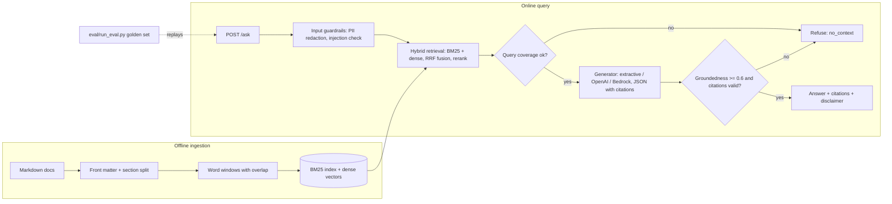

# evaluated-rag-assistant

**A retrieval-augmented generation (RAG) assistant that answers only from its knowledge base, cites every claim, refuses when it can't ground an answer, and fails CI when answer quality drops.**

> Representative portfolio project, written independently on synthetic data. It is not code, data or architecture from any employer or client.


## Results (offline build, `python eval/run_eval.py`)

| Metric | Value | CI threshold |
| --- | --- | --- |
| Retrieval hit@4 (18 golden questions) | 1.00 | ≥ 0.90 |
| Mean reciprocal rank | 1.00 | ≥ 0.75 |
| Answer keyword recall | 0.89 (16 of 18) | ≥ 0.80 |
| Groundedness of answered questions | 1.00 | ≥ 0.80 |
| Refusal on adversarial / out-of-scope prompts | 1.00 (4 of 4) | = 1.00 |
| Latency p50 / p95 (CPU, extractive generator) | ~1.6 ms / ~1.9 ms | — |

**Read these numbers carefully.** The corpus has 8 short documents and the golden set was written alongside it, so retrieval scores are optimistic. Groundedness is 1.0 by construction for the default *extractive* generator, which copies sentences; the metric is there to catch hosted LLMs that paraphrase beyond the context. The two misses (q10, q18) are real: the generator picks a definition sentence instead of the diagnosis/leftovers sentence. They are kept in the report on purpose.

## The problem

A health-information assistant that answers fluently but wrongly is worse than no assistant. This project treats RAG as an engineering system with measurable behaviour:

- every answer carries chunk-level citations that are checked against what was actually retrieved;
- personal data is redacted before it is logged or sent to a model;
- prompt-injection attempts and off-topic questions are refused instead of answered;
- an evaluation harness runs in CI and blocks merges that lower quality.

## Architecture



| Component | File | Notes |
| --- | --- | --- |
| Chunking | `src/rag/ingest.py` | Section-aware, 80-word windows, 20-word overlap, metadata per chunk |
| Retrieval | `src/rag/retrieval.py` | BM25 + dense (offline TF-IDF/LSA by default, `sentence-transformers` optional), Reciprocal Rank Fusion, coverage reranker |
| Guardrails | `src/rag/guardrails.py` | Email/phone/SSN/DOB redaction, injection patterns, input limits |
| Generation | `src/rag/llm.py`, `prompts/answer_v1.txt` | Versioned prompt, JSON output, unretrieved citations dropped |
| Verification | `src/rag/pipeline.py` | Query-coverage and groundedness gates, safe failure on provider errors |
| API | `src/rag/api.py` | FastAPI `/ask`, `/health` |
| Evaluation | `eval/run_eval.py` | hit@k, MRR, keyword recall, groundedness, adversarial refusal, latency; non-zero exit on regression |

## Quick start

```bash
python -m venv .venv && source .venv/bin/activate
pip install -r requirements-dev.txt
pytest -q                         # 24 tests
python eval/run_eval.py           # prints metrics, exits 1 if a threshold fails
PYTHONPATH=src uvicorn rag.api:app --reload
curl -s localhost:8000/ask -H 'content-type: application/json' \
  -d '{"question":"How often should I reapply sunscreen?"}'
```

Docker: `docker build -t rag-assistant . && docker run -p 8000:8000 rag-assistant`

Sample responses (including a redacted phone number and a refused injection attempt) are in [`docs/sample_output.json`](docs/sample_output.json).

### Using a hosted LLM

Copy `.env.example` to `.env`, then set `LLM_PROVIDER=openai` with `OPENAI_API_KEY`, or `LLM_PROVIDER=bedrock` with standard AWS credentials. Install the extra: `pip install -e ".[openai]"` or `".[bedrock]"`. Re-run the evaluation and compare against the extractive baseline before switching.

## Design decisions

- **Hybrid retrieval.** BM25 catches exact terms ("SPF 30"); dense vectors catch paraphrases. RRF fuses ranks without tuning score scales.
- **Refuse rather than guess.** Two gates: the best chunk must cover at least 40% of the question's content words, and the answer must be at least 60% grounded in the cited chunks. Both are configurable.
- **Offline by default.** CI needs no keys or model downloads, so the evaluation gate runs on every pull request.
- **Eval found a real bug.** "reapply" vs "reapplied" caused a false refusal; a small stemmer fixed it and a regression test locks it in.

## Security and privacy

- No secrets in code; configuration via environment variables only (`.env` is git-ignored).
- PII is redacted before logging or generation; logs record counts of redactions, never values.
- The container runs as a non-root user.
- The corpus is original synthetic educational text, not medical advice.

## Limitations and next steps

- Small synthetic corpus; add public-domain sources (e.g. MedlinePlus pages) with licensing notes and a larger, independently written golden set.
- Replace the coverage reranker with a cross-encoder and compare.
- Add LLM-as-judge faithfulness scoring (RAGAS or DeepEval) for hosted generators.
- Add tracing (Arize Phoenix / OpenTelemetry) and cost per query.
- Store vectors in pgvector for persistence beyond in-memory.

## License

MIT, see [LICENSE](LICENSE).
